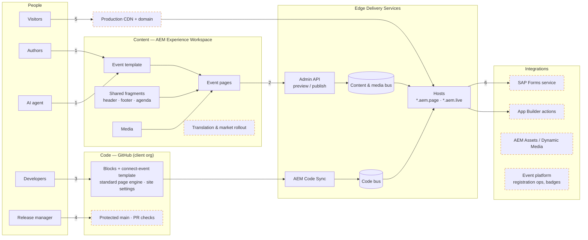

# VEP event sites on AEM Experience Workspace — architecture for review

Date: 2026-10-22 · Reference build: SAP Connect Day Houston
(`vep-connect-event--ew--retesh14.aem.page/vep/us-2026-sap-connect-days-data-it-houston`)

**Terminology.** *AEM Experience Workspace* is Adobe's document-based authoring for Edge Delivery
(Adobe also calls it Document Authoring, DA). It is **not** the JCR-backed setup where pages are
authored in AEM author with Universal Editor — that is a different architecture.

The slides are in [`vep-architecture.html`](vep-architecture.html) — open it in a browser at 1600×900 and
export to PNG or PDF. This page is the narrative behind it.

## Proposal

Build every VEP event site from one template: authors copy `/vep-templates/connect-event` in AEM
Experience Workspace, fill in the event, and publish. Code lives in one client-owned
GitHub repo and ships by merging to `main`. Edge Delivery serves the pages. Registration and event
operations stay in the systems that own them, reached through integrations.

## Flows

1. **Create an event.** An author, or the agent, copies the template and fills in event details. Preview in Experience Workspace.
2. **Publish.** Preview/Publish goes through the Admin API to the content bus. Fragments are published before the page that uses them.
3. **Change code.** A developer pushes a branch; AEM Code Sync updates the code bus; the branch gets its own preview URL.
4. **Release code.** Pull request with lint and PageSpeed checks, then review, then merge to `main`.
5. **Serve.** Visitor → CDN → `.aem.live`: HTML plus the blocks and CSS the page needs.
6. **Register.** The form block hands off to the SAP Forms service (target state). Live event data, if needed, comes through App Builder.

## Built in the POC vs. to build

| Built and demonstrable | To build before production |
|---|---|
| Template, event pages, shared fragments, media folders in Experience Workspace | Client-owned GitHub org, protected `main`, CODEOWNERS, bot identity for the agent |
| Blocks: hero, columns, card, advanced-tabs (agenda accordion), form, fragment, header, footer | Production CDN, custom domain, push invalidation; protected QA domain |
| `connect-event` template theme; each event gets its own header/footer from its URL | Publish roles and preview authentication in site config |
| Second event rolled out from the template (Chicago) | SAP Forms integration (submit is stubbed; dropdowns are placeholders) |
| Authorable registration form (labels, options) | App Builder actions for live data and market image variants |
| Market rollout PoC: language master → `en/us`, `en/gb`, UK image variant applied automatically | Chicago registration page (currently 404) |

## Lessons from building the reference page

Two events built (Houston migrated, Chicago from the template), one blank template, and a two-market
rollout PoC. On the `vep-connect-event` branch, 15 of 30 commits were fixes — fidelity and behaviour
corrections found while building. Each lesson below is now a rule in the proposal.

| Area | What happened in the build | Rule we propose |
|---|---|---|
| Migration | The source site blocks direct fetches (403); scraping needed a real browser | Budget browser-based import tooling for SAP sources |
| Migration | Tracking pixels were imported as content and stretched the page by ~12,000px | Importer cleanup strips tracking and analytics markup before content lands in Experience Workspace |
| Migration | 48 image URLs on the Houston page point at the POC host; some logo alt texts were wrong | Media referenced by relative path; alt text is a QA checkpoint |
| Blocks | The tabs block absorbed every following section as tab panels | Complex components (agenda) live in their own fragment |
| Blocks | The vendored form block needed a compatibility shim, a grid override and a specific JSON envelope | Third-party blocks get an adapter layer; Adobe's standard page engine (`ak.js`) stays untouched |
| Blocks | Header/footer page settings didn't work as fragment paths, so event pages showed the wrong header and footer | Each event gets its own header/footer based on its URL, with a shared fallback |
| Design | First pass used a dark theme; the source is light. Intro clipping, sponsor tiers, two-column form and floating labels each took rounds | Side-by-side visual check against the source is in the definition of done |
| Template | The blank template showed broken images and a fragment error in the Experience Workspace editor; Chicago's registration page was never created | Templates use text placeholders; an "event kit" includes child pages (registration) |
| Publishing | Pages published before their header/footer fragments showed red error boxes | Release order code → fragments → page; publish rights limited to release managers |
| Rollout | The Translate app's rollout created market pages without previewing them; the variant swap left the master's alt text | Rollout config auto-previews; the variant mapping carries alt text |
| Integration | SAP's real form is a shared Form.io form with consents and channels our copy lacks; submit is stubbed | Decide embed-vs-API with the SAP forms team before building more events |

## Decisions asked of the board

1. **Content in AEM Experience Workspace** (document-based), not AEM author (JCR) with Universal Editor. One content source; separation by Preview vs Publish and release order.
2. **One code repo, owned by the client**, with branches as environments and GitHub checks as the quality gate. No Cloud Manager pipeline for this site.
3. **Integrate, don't replace**, for registration and event operations: SAP Forms service and the event platform remain systems of record.
4. **Server-side integrations through App Builder**, so credentials never reach the browser.

## Non-functional targets

- Performance: Lighthouse 100 target, enforced as a PR check; RUM in production.
- Security: no secrets in the repo (the site code is public by nature); publish restricted to release managers; preview protected.
- Privacy: registration data goes only to SAP systems; consent texts come from the SAP Forms service.
- Operability: rollback through Experience Workspace version history and Git revert; one runbook for publish failures.

## Risks and open questions

| Risk / question | Mitigation or owner |
|---|---|
| SAP Forms submission API, auth, and per-event questions are not yet confirmed | SAP forms team; integration design before build |
| Experience Workspace / agent entitlement on the client's Adobe Org | Adobe account team |
| Absolute media URLs (48 on the Houston page) point at the POC site | Rewrite to relative paths before moving to the client org |
| Merge rollout may not preserve market image variants | Merge test pending; fallback is re-running the variant step |
| Our copy of Adobe's standard page engine (`ak.js`, from the Author Kit starter) is behind Adobe's latest | Update it from Adobe before production; never edit it in the project |
